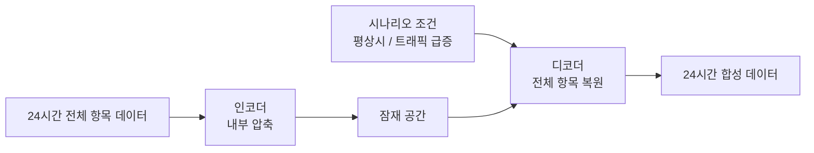

# TelcoGen — 통신 기지국 성능 데이터 합성 및 시뮬레이터 연동

> 삼성청년SW·AI아카데미 자율 프로젝트 (기업 연계)
> 기업 연계 프로젝트로 진행되어 **코드와 데이터는 공개하지 않습니다.** 이 저장소에는 프로젝트 개요와 제가 맡은 역할, 문제 해결 과정만 정리했습니다.

<br>

## 프로젝트 개요

| 항목 | 내용 |
|---|---|
| 기간 | 2026.04 ~ 2026.06 (2개월, 삼성전자 네트워크사업부 상주) |
| 팀 구성 | 6명, 5개 트랙 (전처리 · 라벨링 · 항목 매핑 · 생성 모델 · 검증 및 시뮬레이터 통합) |
| 내 역할 | **검증 및 시뮬레이터 통합 트랙 담당** (초기에는 데이터 전처리) |
| 사용 기술 | Python, pandas, Linux |

데이터가 풍부한 해외 통신사 A의 기지국 성능(PM) 데이터를 바탕으로, 데이터가 부족한 해외 통신사 B의 성능 데이터를 AI로 합성하는 과제였습니다. 합성한 데이터는 실제 운영 중인 시뮬레이터에서 사용할 수 있어야 했습니다.

- 원본 데이터 규모: 약 50TB (압축 해제 기준)
- 두 통신사 데이터를 연결할 기준 컬럼과 설명 자료가 거의 없는 상태에서 시작

<br>

## 팀의 생성 모델 (모델 담당 팀원 작업)

모델 설계와 학습은 팀의 모델 담당 팀원이 맡았고, 저는 이 모델을 시뮬레이터에 연결하는 작업을 맡았습니다.

- **방식**: CVAE 계열 조건부 생성 모델
- **입력과 출력**: 기지국 성능 항목 전체를 줄이지 않고 1시간 단위 24시간 구간을 그대로 생성
- **조건**: 평상시(normal)와 트래픽 급증(traffic surge) 두 가지 시나리오
- **특징**: 모델 내부에서만 차원을 압축하고 출력은 항상 전체 항목을 복원



<br>

## 진행 흐름

프로젝트 기간 동안 방향이 여러 번 바뀌었고, 그때마다 목표를 다시 확인하며 진행했습니다.


| 시기 | 팀의 방향 | 내 역할 |
|---|---|---|
| 4월 말 | 데이터 이해, 클러스터링 방식 검토 | 데이터 전처리, 샘플링 전략 조사, 데이터 규모 산정 |
| 5월 초 | AI 생성 모델로 방향 확정, 5개 트랙으로 분담 | 검증 트랙 담당 확정, 검증 체계 설계와 검증 코드 작성, 시뮬레이터 분석 |
| 5월 중순 이후 | 시뮬레이터와 모델 연동 | 시뮬레이터 생성부를 모델로 교체하는 이식 작업, 인수인계 |

<br>

## 내가 한 일

### 1. 낯선 도메인 학습과 회의 기록 공유
- 통신 데이터는 처음 다루는 분야였습니다. 팀원이 정리한 용어집으로 데이터 구조를 공부하고, 모르는 부분은 현업 멘토에게 사소한 것까지 질문했습니다.
- 회의 내용은 빠짐없이 기록해 팀원들과 공유했습니다. 프로젝트 기간 동안 자료 19건을 정리했습니다.
- 팀과 현업에서 받은 자료 15건을 종류, 신뢰도, 내 작업에서의 활용도로 분류한 인덱스를 만들어 어떤 자료를 기준으로 삼을지 먼저 정했습니다.
- 문서에 없던 규칙들을 회의로 확인했습니다.
  - 파일 이름의 시각은 그 앞 15분 동안의 데이터를 의미함
  - 항목(counter) 이름이 같아도 속한 묶음(family)이 다르면 다른 값으로 취급해야 함

### 2. 하드웨어 제약 기반 데이터 규모 산정
"데이터를 얼마나 줄여야 하는가"라는 질문에 감이 아닌 숫자로 답하기 위해, 모델 사양, 하드웨어 사양, 데이터 형태, 허용 학습 시간, 안전 여유의 5가지 조건을 기준으로 목표 데이터 크기를 단계별로 계산했습니다.

```
원본 데이터 (수십 TB)
   ↓ 기간 샘플링
   ↓ 시간 단위 샘플링
   ↓ 핵심 항목 선별
최종 학습 입력 (수백 GB 수준)
```

- 로컬 디스크와 메모리로는 하루치 데이터도 한 번에 올리기 어려워 스트리밍 처리가 필요하다는 점을 함께 정리했습니다.
- 드물게 나타나는 패턴이 사라지지 않도록, 무작위 샘플링 대신 비슷한 데이터끼리 묶은 뒤 묶음별로 고르게 뽑는 층화 샘플링 방식을 조사했습니다.
- 이후 팀은 데이터를 약 1TB 규모로 줄여 학습과 개선 사이클을 반복했습니다.

### 3. 합성 데이터 신뢰성 검증 체계 설계
합성 데이터가 "쓸 만한지"를 하나의 지표로 판단하기 어렵다고 보고, 4개 층 7가지 검증으로 나눈 검증 체계를 설계했습니다. 각 검증마다 합격 기준을 먼저 정해 두었습니다.

| 층 | 검증 | 확인하는 것 | 합격 기준 |
|---|---|---|---|
| 통계적 유사성 | 분포 일치 | 합성 데이터의 분포가 실제 데이터와 비슷한가 | KS 통계량 0.1 미만 |
| | 관계 보존 | 항목 간 상관관계(예: 트래픽 증가 시 전력 증가)가 유지되는가 | 상관 오차 0.15 미만 |
| | 규칙 준수 | 물리적으로 가능한 값 범위를 지키는가 | 위반율 5% 미만 |
| 다양성 | 복사 방지 | 실제 데이터를 단순히 복사하지 않았는가 | 최근접 거리로 확인 |
| 의미적 가치 | 시나리오 제어 | 의도한 시나리오(평상시, 트래픽 급증)대로 생성되는가 | 적중률 80% 초과 |
| | 실무 활용 | 합성 데이터로 학습한 모델이 실제 데이터에서도 동작하는가 | 베이스라인 대비 성능 |
| 운영 호환성 | 형식 호환 | 시뮬레이터에 바로 입력 가능한 형식인가 | 4종 데이터 모두 통과 |

- **베이스라인 비교:** 생성 모델이 단순한 방법보다 나은지 보이기 위해, 실제 데이터 복사, 노이즈 추가, 항목별 독립 샘플링의 3가지 베이스라인과 같은 기준으로 비교하도록 설계했습니다.
- **선행 작업 분리:** 생성 모델 결과는 일정 후반에야 나올 예정이었습니다. 그래서 모델 결과 없이도 할 수 있는 일(평가 함수, 결과 그림 템플릿, 도메인 규칙 목록, 임시 데이터로 전체 파이프라인 사전 실행)을 앞당겨 끝내고, 결과를 받으면 바로 평가할 수 있게 준비했습니다.
- **산출물 정의:** 비교표, 평가 보고서, 호환성 테스트 로그, 결과 그림 등 검증 산출물 12종을 정의하고 각 산출물이 어떤 검증을 뒷받침하는지 연결했습니다.
- **검증 도구:** 시나리오 적중률을 측정할 경량 분류기 학습과, 합성 데이터로 이상 탐지 모델을 학습해 실제 데이터로 평가하는 TSTR(Train on Synthetic, Test on Real) 검증은 팀원들과 함께 진행했습니다.
- 검증 항목별 체크리스트(11개 항목)와 검증용 스크립트를 작성했고, 합성 데이터를 받은 뒤 이 체계로 검증을 진행했습니다.

### 4. 시뮬레이터 분석과 AI 모델 이식
- 보안 정책상 코드를 외부로 반출할 수 없어, 사내 AI 도구로 시뮬레이터 코드를 모듈 단위로 분석했습니다.
- 여러 모듈을 하나씩 확인한 끝에 성능 데이터를 실제로 만드는 부분이 **내부 무작위 생성기**라는 것을 찾았습니다.
- 이 무작위 생성 부분을 팀이 만든 AI 모델의 출력값으로 교체하는 이식 작업을 맡았습니다.
- 운영 중인 시뮬레이터를 다루는 만큼 안정성을 함께 고려했습니다.
  - **모드 전환:** 환경 변수로 기존 무작위 생성과 AI 모델 생성을 선택할 수 있게 해, 문제가 생기면 기존 방식으로 바로 되돌릴 수 있도록 했습니다.
  - **추론 캐시:** 시뮬레이터가 일정 주기마다 장비 단위로 데이터를 요청하는 특성을 활용해, 장비 단위로 추론 결과를 저장해 같은 조건의 반복 추론을 줄였습니다.
  - **범위 보정:** 모델 출력이 도메인 범위를 벗어나면 자동으로 보정했습니다. 음수 제거, 정수 항목 반올림, "시도 횟수 ≥ 성공 횟수" 같은 규칙을 적용했습니다.


<br>

## 트러블슈팅

### 1. 시뮬레이터의 역할을 잘못 이해함
| | |
|---|---|
| 문제 | 시뮬레이터로 합성 데이터를 검증하려 했지만, 코드를 분석해도 데이터를 입력받는 기능을 찾을 수 없었습니다. |
| 원인 | 시뮬레이터를 "데이터 검증 도구"로 가정하고 분석했지만, 실제로는 내부에서 데이터를 무작위로 생성하는 구조였습니다. |
| 해결 | 현업 담당자에게 다시 질문해 작업의 본질이 "형식 검증"이 아니라 "생성부를 모델로 교체하는 통합 작업"임을 확인했습니다. 이후 설명을 단계별로 적어 한 단계씩 확인받으며 진행했습니다. |
| 결과 | 작업 범위를 다시 정의해 남은 기간을 실제 통합 작업에 집중할 수 있었습니다. |

### 2. 생성된 데이터 파일이 읽히지 않음
| | |
|---|---|
| 문제 | 시뮬레이터가 만든 데이터 파일을 불러오면 파싱 오류가 발생했습니다. |
| 원인 | 파일 상단에 데이터 묶음과 항목 이름을 설명하는 주석 줄이 붙어 있었고, 이 줄의 칸 수가 실제 데이터와 달랐습니다. |
| 해결 | 주석 줄은 건너뛰고, 항목 이름이 담긴 줄만 추출해 헤더로 사용하도록 처리한 뒤 여러 파일을 하나로 병합했습니다. |
| 결과 | 생성된 파일을 정상적으로 불러와 결과를 확인할 수 있게 되었습니다. |

### 3. 모델 값을 넣었는데 결과가 계속 무작위로 나옴
| | |
|---|---|
| 문제 | 모델 출력값을 주입하는 코드를 작성했지만, 결과 파일에는 계속 무작위 값이 나왔습니다. |
| 원인 | 채팅창에서 코드를 복사하는 과정에서 초기화 함수 이름의 밑줄 두 개(`__init__`)가 하나(`_init_`)로 바뀌었습니다. 초기화가 실행되지 않아 모델 값이 비어 있었고, 시뮬레이터는 기본 무작위 생성으로 돌아가고 있었습니다. |
| 해결 | 복사 대신 직접 입력해 함수 이름을 바로잡았습니다. |
| 결과 | 모델 값이 시뮬레이터 안에서 정상 반영되는 것을 확인했습니다. 이후로는 결과가 이상하면 실제로 실행된 코드부터 확인하는 습관을 갖게 되었습니다. |

<br>

## 돌아보며

### 잘한 점
- **판단 기준을 먼저 정리했습니다.** 현업 담당자마다 의견이 달라 방향이 자주 흔들렸습니다. 회의 발언을 누가 했는지까지 기록하고, 모델과 방향성은 AI 담당자의 의견을, 데이터 양과 범위는 데이터 담당자의 의견을 우선한다는 기준을 정리해 팀이 같은 문제를 다시 논쟁하지 않도록 했습니다.
- **AI 도구의 역할을 나눠서 썼습니다.** 실데이터와 코드를 외부로 반출할 수 없는 환경이었기 때문에 외부 AI는 방향 검토와 코드 골격과 문서 작성에만 쓰고, 실데이터 분석과 검증은 사내 환경에서만 진행했습니다.
- **주장할 수 있는 것과 없는 것을 구분했습니다.** 검증 결과를 정리하면서 "실제 망을 대체할 수 있다"처럼 검증하지 않은 내용은 결론에서 빼고, 측정한 지표로 확인된 내용만 남겼습니다.

### 아쉬운 점
- **시스템 구조를 늦게 확인했습니다.** 시뮬레이터를 검증 도구로 가정한 채 검증 코드를 먼저 만들었고, 시뮬레이터가 내부에서 데이터를 직접 생성하는 구조라는 것을 알았을 때 그동안 준비한 일부 작업을 다시 해야 했습니다.
- **AI 분석 결과를 너무 믿었습니다.** 사내 AI 도구가 시뮬레이터에서 엉뚱한 모듈을 가리키는 일이 반복됐고, 이를 알아차리기까지 시간이 걸렸습니다.
- **실제 데이터로 검증할 시간이 부족했습니다.** 라벨링과 모델 개발이 늦어지면서 검증 체계를 실제 합성 데이터에 충분히 반복 적용하지 못한 채 인수인계해야 했습니다.

### 다음에는
- 새 시스템을 다룰 때는 코드를 만들기 전에 입력과 출력이 실제로 어떻게 흐르는지부터 담당자와 함께 확인하겠습니다.
- AI가 분석한 결과는 실제 코드와 실행 결과로 한 번 더 확인한 뒤에 다음 단계로 넘어가겠습니다.
