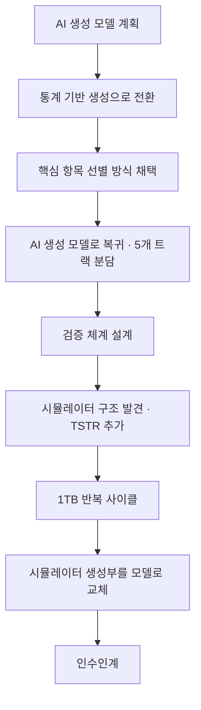

# 의사결정 기록

[← README로 돌아가기](../README.md)

프로젝트 기간 동안 방향이 여러 번 바뀌었습니다. 바뀔 때마다 무엇을 근거로 판단했고 내 작업에 어떤 영향이 있었는지 기록한 내용을 정리했습니다.
사내 정보와 개인 이름은 제외하고 역할로만 표기했습니다.

 

## 판단 기준 정하기 (4월 말)

현업 담당자마다 전문 분야가 달라 같은 주제에 서로 다른 의견이 나왔습니다. 의견이 엇갈릴 때마다 논쟁이 반복되지 않도록 **기준을 먼저 정했습니다.**

- 회의 발언은 누가 한 말인지까지 기록
- **데이터 양과 범위**에 관한 판단은 데이터 담당 현업의 의견을 우선
- **모델과 방법론, 방향성**에 관한 판단은 AI 담당 현업의 의견을 우선
- 두 의견이 겉보기에 충돌하면 먼저 서로 다른 단계의 이야기인지 확인

 

## 결정 기록

### 1. AI 생성 모델 → 통계 기반 생성 (4월 말)
| | |
|---|---|
| 상황 | 처음에는 시계열 생성 AI 모델로 데이터를 합성할 계획이었습니다. |
| 새로운 의견 | 데이터 담당 현업은 값의 범위(최소·최대)만 잘 맞추면 통계 기반 단순 생성으로도 충분하다고 보았습니다. |
| 결정 | AI 생성은 후순위로 두고 통계 기반 생성 방향으로 전환했습니다. |
| 내 작업 영향 | 생성 모델 학습 준비는 보류하고, 검증 체계를 "시뮬레이터 결과"가 아닌 "근거 설명" 중심으로 다시 설계하기로 했습니다. |

### 2. 카테고리 단위 클러스터링 기각 (4월 말)
| | |
|---|---|
| 상황 | 항목들을 이미 정해진 카테고리 안에서만 묶어 클러스터링하자는 제안이 두 차례 나왔습니다. |
| 반대 근거 | AI 담당 현업은 통신망 상태가 여러 항목의 상관관계로 결정되고, 그 상관관계는 카테고리를 넘어서도 존재하기 때문에 위험하다고 보았습니다. |
| 결정 | 방향성에 관한 판단이므로 AI 담당 현업의 의견을 따라, 카테고리 단위 대신 **핵심 항목을 선별하는 방식**으로 바꿨습니다. |

### 3. "전체를 다 봐야 한다" vs "일부만 쓰자" (4월 말)
| | |
|---|---|
| 상황 | 한쪽에서는 데이터를 빠짐없이 봐야 한다고 했고, 다른 쪽에서는 기간과 시간 단위로 샘플링해 일부만 쓰자고 했습니다. |
| 해석 | 두 의견이 같은 단계의 이야기가 아니라고 판단했습니다. 전체 데이터 검토는 중요한 항목을 놓치지 않기 위한 단계이고, 샘플링은 학습 입력을 만드는 단계입니다. |
| 결정 | 두 단계로 나눠 양립시켰습니다. |

### 4. "얼마나 줄여야 하는가"에 숫자로 답하기 (4월 말)
| | |
|---|---|
| 질문 | AI 담당 현업이 하드웨어와 모델을 고려하면 데이터를 얼마나 줄여야 하는지 감이 있느냐고 물었습니다. |
| 접근 | 모델 사양, 하드웨어 사양, 데이터 형태, 허용 학습 시간, 안전 여유의 5가지 조건을 정리하고, 단계별 샘플링 후 예상 크기를 계산했습니다. |
| 결과 | 디스크와 메모리 한계 때문에 스트리밍 처리가 필요하다는 점과, 단계별 축소 후 학습 입력이 수백 GB 수준이 된다는 점을 근거와 함께 공유했습니다. |

### 5. 다시 AI 생성 모델로, 5개 트랙 분담 (5월 초)
| | |
|---|---|
| 상황 | 3주 일정의 축소안이 제시되면서 다시 조건부 생성 모델(CVAE 계열)을 쓰는 방향으로 돌아왔습니다. |
| 결정 | 팀을 전처리, 라벨링, 항목 매핑, 생성 모델, 검증 및 시뮬레이터 통합의 5개 트랙으로 나눴고, 저는 **검증 및 시뮬레이터 통합 트랙**을 맡았습니다. |
| 내 대응 | 그때까지 받은 자료 15건을 신뢰도와 활용도로 분류해 기준 자료를 정하고, 검증 트랙의 산출물과 일정을 다시 정의했습니다. 다른 트랙 결과에 의존하는 작업과 그렇지 않은 작업을 나눠, 의존하지 않는 작업을 먼저 진행하도록 계획했습니다. |

### 6. 사내 AI 도구의 분석이 계속 빗나감 (5월 초)
| | |
|---|---|
| 상황 | 시뮬레이터에서 성능 데이터를 처리하는 부분을 찾기 위해 AI 도구로 코드를 분석했지만, 성능 데이터와 무관한 모듈을 계속 가리켰습니다. |
| 판단 | 결과가 반복해서 틀리는 것은 분석 방식 자체의 문제라고 보고, 질문 방식을 바꿔 "성능 데이터를 처리하는 모듈을 찾아 달라"는 식으로 범위를 좁혀 다시 요청했습니다. |
| 결과 | 시뮬레이터 대부분이 인프라와 운영 영역을 다루는 모듈이고, 성능 데이터와 관련된 부분은 따로 있다는 것을 파악했습니다. |

### 7. 클러스터링을 하지 않기로 결정 (5월 초)
| | |
|---|---|
| 상황 | 클러스터링을 하면 학습과 작업량이 늘어난다는 이유로 의견이 갈렸고, 팀 회의에서 클러스터링과 카테고리를 고려하지 않기로 결정했습니다. |
| 내 대응 | 결정 직후 내 산출물마다 영향 정도를 점검했습니다. 평가 코드가 이미 카테고리와 무관한 구조여서 작은 수정만으로 그대로 진행할 수 있다는 것을 확인했습니다. |

### 8. 시뮬레이터가 합성 데이터를 받지 않는 구조임을 발견 (5월 중순)
| | |
|---|---|
| 상황 | 성능 데이터 시뮬레이터를 분석해 보니 외부 데이터를 입력받지 않고 내부에서 무작위로 값을 만드는 구조였습니다. |
| 영향 | "합성 데이터를 시뮬레이터에 넣어 검증한다"는 기존 가정이 성립하지 않아, 준비하던 호환성 검증 계획을 다시 정리해야 했습니다. |
| 대응 | 통계 지표만으로는 실제 가치를 보이기 어렵다고 보고, 합성 데이터로 학습한 모델을 실제 데이터로 평가하는 **TSTR 검증 축을 추가**했습니다. |

### 9. 데이터를 줄여 반복 사이클로 전환 (5월 중순)
| | |
|---|---|
| 상황 | 남은 기간 안에 전체 규모로 결과를 내기 어려웠습니다. |
| 결정 | 데이터를 약 1TB로 줄여 전처리부터 생성, 검증까지의 사이클을 반복하며 개선하는 방식으로 바꿨습니다. |

### 10. 작업의 본질이 "형식 검증"에서 "실제 통합"으로 (5월 중순)
| | |
|---|---|
| 상황 | 현업 담당자에게서 시뮬레이터 내부의 무작위 생성부를 우리 모델로 교체하면 된다는 정보와 테스트 환경을 받았습니다. |
| 판단 | 내 작업이 "입력 형식이 맞는지 확인하는 일"이 아니라 "시뮬레이터 안에 모델을 넣는 일"로 바뀌었다고 정리했습니다. |
| 결정 | 검증 실행 일부는 팀원에게 넘기고, 남은 기간을 모델 이식 작업에 집중했습니다. |
| 결과 | 모드 전환, 추론 캐시, 범위 보정을 갖춘 이식 코드를 작성해 시뮬레이터 안에서 모델이 동작하는 것을 확인한 뒤 인수인계했습니다. |

 

## 흐름 요약

